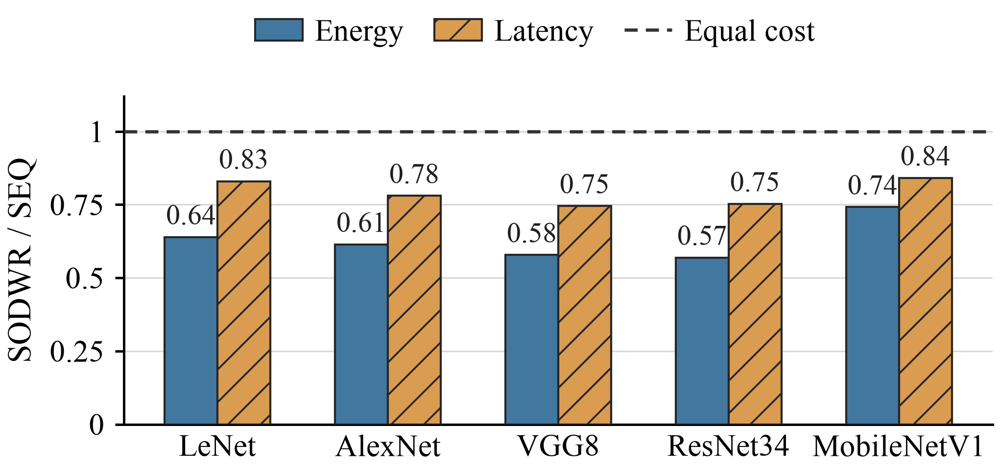

# SPARKSIM

**A Simulator for Spiking Neural Networks on RRAM Compute-in-Memory Architectures**

SPARKSIM 是面向脉冲神经网络（SNN）的 RRAM 存内计算仿真器，用于评估网络在有限阵列资源下的权重部署与推理开销。它支持软件训练、量化感知微调、网络映射和权重调度，提供准确率、延迟、能耗、面积及吞吐指标。

## 主要功能

- **SNN 建模**：支持多时间步 LIF 网络、卷积下采样、残差连接和多分支结构。
- **训练与量化**：提供软件预训练及 `FIX_TRAIN` 量化感知训练（QAT），支持固定精度、逐层位宽和非均匀激活配置。
- **器件与映射**：支持 ASU、PKU 两组 256 电导状态器件模型、差分 RRAM 映射及跨阵列分片。
- **资源约束下的执行**：规划权重更新轮次，维护 LIF 状态、partial sum 和层间数据依赖。
- **可扩展调度**：支持内置策略、冻结方案回放和版本化 JSON 自定义调度接口。
- **硬件评估**：分别报告权重编程与推理成本，并提供组件能耗和计算来源。

硬件评估分为两个阶段：**Phase 1** 完成网络分片和轮次规划，**Phase 2** 执行计划并统计开销。典型流程为：

```text
软件预训练 → QAT 微调 → 器件与资源配置 → 调度生成 → 权重编程与推理评估
```

已有匹配权重时，可直接从硬件评估开始。仓库包含源码、配置、器件表和测试；数据集与训练权重需自行准备。

## 调度实验示例

下图展示五种网络在 Stanford/ASU 器件模型下，SODWR 相对于顺序调度（SEQ）的归一化能耗与延迟。实验使用 16 个 `128×128` 物理阵列、9 位有符号权重和 30 个时间步。



横轴为 SODWR/SEQ，虚线表示两种调度开销相同。该图来自项目论文中的既有实验结果，展示的是特定模型与硬件配置下的评估数据，不代表本仓库当前内置策略的复现实验结果。图中各网络能耗降低 25.82%–43.05%，延迟降低 15.89%–25.45%。

## 使用导航

- [安装](#安装)
- [快速开始](#快速开始)
- [支持的网络与数据格式](#支持的网络与数据格式)
- [训练与量化](#训练与量化)
- [准确率评估](#准确率评估)
- [硬件与器件配置](#硬件与器件配置)
- [权重调度](#权重调度)
- [自定义调度算法](#自定义调度算法)
- [结果与指标](#结果与指标)
- [测试与常见问题](#测试与常见问题)
- [项目结构](#项目结构)
- [开发与文档](#开发与文档)

## 安装

推荐环境为 Linux、Bash 和 Conda。以下示例使用 Python 3.12、PyTorch 2.5.1 与 SpikingJelly 0.0.0.0.14。CPU 可以执行测试和硬件评估；训练和大规模准确率评估推荐使用 NVIDIA GPU。

### 获取源码与创建环境

```bash
git clone https://github.com/Lucia-vows-flame/SPARKSIM.git
cd SPARKSIM/SPARKSIM

conda create -n sparksim python=3.12 pip -y
conda activate sparksim
```

后续命令均在运行目录 `SPARKSIM/`（包含 `SimConfig.ini`）中执行。项目从源码运行，无需安装为 Python 包。内部包名及环境变量保留 `MNSIM`。

### 安装依赖

选择与机器匹配的 PyTorch 安装方式。GPU 版本使用 CUDA 12.1 wheel，需要兼容的 NVIDIA 驱动。

```bash
# NVIDIA GPU
python -m pip install torch==2.5.1 torchvision==0.20.1 \
  --index-url https://download.pytorch.org/whl/cu121
```

<details>
<summary>仅使用 CPU</summary>

```bash
# CPU
python -m pip install torch==2.5.1 torchvision==0.20.1 \
  --index-url https://download.pytorch.org/whl/cpu
```

</details>

安装其余常用依赖：

```bash
python -m pip install spikingjelly==0.0.0.0.14 numpy scipy pandas matplotlib tqdm pytest
```

上述依赖覆盖本教程的主要流程。可选的 DDR/NoC 后端需单独安装外部工具；快速开始使用的配置已关闭这两个后端。

### 检查安装

```bash
python -c 'import sys, torch, spikingjelly; print(sys.executable); print(torch.__version__); print("CUDA:", torch.cuda.is_available()); print("GPUs:", torch.cuda.device_count())'
export MNSIM_PYTHON="$(command -v python)"
bash scripts/run_round_orchestrated_sim.sh --help
python scripts/train_snn_v7.py --help
python scripts/finetune_snn_v7.py --help
```

`MNSIM_PYTHON` 控制 Shell 仿真入口使用的解释器。仿真的 CPU 参数为 `--device cpu`，GPU 参数可以是 `--device 0` 或 `--device cuda:0`；训练脚本使用 `--device cuda:0` 或 `--device cpu`。

## 快速开始

以下示例使用 VGG8、ASU 器件和 16 个物理阵列，评估一次执行计划中的权重编程与推理开销。请准备与网络匹配、包含有效量化范围的 QAT 权重 `*_best.pth`，并替换示例中的绝对路径。此流程只运行硬件成本模型，无需数据集。

### 准备权重

```bash
export NETWORK=vgg8_snn_v7_phase6
export WEIGHTS=/absolute/path/to/vgg8_snn_v7_phase6_software_qat_finetune_best.pth
export MNSIM_SNN_SEQUENCE_LENGTH=30
export MNSIM_PYTHON="$(command -v python)"
```

### 生成硬件配置

从随附的资源配置生成 ASU 器件配置：

```bash
python -m scripts.apply_final_rram_model \
  --base-sim-config configs/hardware/SimConfig_16xbar_square_asu.ini \
  --device-model rram_stanford_asu_256 \
  --output runs/configs/asu_16xbar.ini
```

配置中的外围模型路径相对于 INI 所在目录解析。将配置生成到 `runs/configs/` 后，更新该引用：

```bash
python - <<'PY'
import configparser
from pathlib import Path

path = Path("runs/configs/asu_16xbar.ini")
config = configparser.ConfigParser()
config.read(path)
config.set("SNN Peripheral Energy", "Profile",
           str(Path("configs/peripherals/asu_rram_snn_circuit_v1.json").resolve()))
with path.open("w") as stream:
    config.write(stream)
PY
```

复制或移动其他配置时，也需同步更新其中的相对路径。

### 运行硬件评估

```bash
bash scripts/run_round_orchestrated_sim.sh \
  --network "$NETWORK" \
  --weights "$WEIGHTS" \
  --num-classes 8 \
  --sim-config runs/configs/asu_16xbar.ini \
  --output-dir runs/vgg8_asu_seq \
  --device cpu \
  --skip-accuracy \
  --run-hardware \
  --schedule-policy seq \
  --show-rounds
```

结果保存至 `runs/vgg8_asu_seq/`。终端会显示总延迟、能耗、读写分项、面积和吞吐指标，也可读取聚合结果：

```bash
python - <<'PY'
import json
from pathlib import Path

hardware = json.loads(Path("runs/vgg8_asu_seq/summary.json").read_text())["hardware"]
for name in ("latency_s", "energy_j", "tops_per_w", "area_um2"):
    print(f"{name}: {hardware.get(name)}")
PY
```

这组参数中，`--skip-accuracy` 跳过数据集准确率测试，`--run-hardware` 启用硬件指标，`--schedule-policy seq` 选择顺序调度。硬件路径按网络拓扑、时间步和状态依赖计算开销；逐样本数值推理使用[准确率评估](#准确率评估)入口。成本模型的假设见[能耗模型与统计范围](#能耗模型与统计范围)。

默认会执行准确率评估；硬件评估由 `--run-hardware` 显式启用。

## 支持的网络与数据格式

### 支持的网络

训练和仿真入口使用下列网络名称：

| 网络 | `--model` / `--network` |
| --- | --- |
| LeNet | `lenet_snn_v7_phase6` |
| AlexNet | `alexnet_snn_v7_phase6` |
| VGG8 | `vgg8_snn_v7_phase6` |
| VGG11 | `vgg11_snn_v7_phase6` |
| VGG13 | `vgg13_snn_v7_phase6` |
| VGG16 | `vgg16_snn_v7_phase6` |
| MobileNet | `mobilenet_snn_v7_phase6` |
| ResNet18 | `resnet18_snn_v7_phase6` |
| ResNet34 | `resnet34_snn_v7_phase6` |
| ResNet50 | `resnet50_snn_v7_phase6` |
| Inception | `inception_snn_v7_phase6` |

以上网络均为适配 V7 输入的 SNN 定义，采用卷积下采样，并通过图节点和显式 LIF 边界表示残差与分支。训练权重需与对应定义匹配；torchvision 的同名 ANN 权重不能直接加载。

### V7 数据格式

V7 训练入口使用 **8 类、6 通道、默认 30 时间步**，空间输入为 `32×32`。数据按以下结构存放，每个划分目录直接包含逐样本 `.npz` 文件：

```text
your_v7_dataset/
├── meta.json
├── pretrain/
│   └── sample_000000.npz
├── finetune/
│   └── sample_000000.npz
├── calibration/
│   └── sample_000000.npz
└── test/
    └── sample_000000.npz
```

`meta.json` 示例：

```json
{"T_bins": 30, "C": 6, "H": 32, "W": 32, "num_classes": 8}
```

每个样本保存：

| 字段 | 要求 |
| --- | --- |
| `x_seq` | `[T,C,H,W]` 张量，V7 为 `T=30,C=6`；兼容字段名 `x` |
| `y` | 整数类别 `0..7`；兼容字段名 `label` |

加载器将正数转为 `1`，其余转为 `0`，并用空间 OR 聚合将输入调整为目标尺寸。通道数需与模型匹配，V7 入口要求六通道输入。

四个数据划分分别承担以下用途，样本应相互独立：

| 用途 | 读取的 split |
| --- | --- |
| 软件预训练更新参数 | `pretrain` |
| QAT 微调更新参数 | `finetune` |
| 训练/QAT 选择最佳 checkpoint | `calibration` |
| 最佳 checkpoint 的最终测试 | `test` |
| 正式 PIM 准确率的 ReADC 校准 | `pretrain`，在适配器中逻辑标记为 `train` |
| 正式准确率评估 | `test` |

适配其他任务时，需要同步调整网络定义、训练入口、数据格式和权重。当前训练脚本固定构建 8 类模型，仿真参数 `--num-classes` 应与权重的输出维度一致。

### 权重文件

| 文件 | 用途 |
| --- | --- |
| `*_best.pth` | 模型 state dict，用于仿真或微调 |
| `*_latest.pth` | 含优化器、调度器和随机状态的训练恢复文件 |

评估时保持网络名称、类别数、LIF 参数、分类读出和量化策略与训练一致。残差、BN 和 post-add 硬件域依赖校准范围，推荐使用完成 QAT 的权重。默认 LIF 参数为 `tau=50.5016666556`、阈值 `0.01`、reset `0`；自定义参数可通过对应环境变量设置：

```bash
export MNSIM_SNN_LIF_TAU=50.5016666556
export MNSIM_SNN_LIF_V_TH=0.01
```

## 训练与量化

训练分为软件预训练和 QAT 微调两个阶段。以下以 VGG8 为例，轮数、学习率和 batch size 可按任务与显存调整。已有 QAT 权重可直接进入评估。

### 软件预训练

```bash
export DATASET_ROOT=/absolute/path/to/your_v7_dataset
python scripts/train_snn_v7.py \
  --model vgg8_snn_v7_phase6 \
  --dataset-root "$DATASET_ROOT" \
  --sim-config SimConfig.ini \
  --output-dir runs/vgg8_pretrain \
  --device cuda:0 \
  --epochs 60 \
  --train-batch 8 \
  --test-batch 8 \
  --learning-rate 0.01 \
  --seed 42
```

主要产物：

```text
vgg8_snn_v7_phase6_software_pretrain_best.pth
vgg8_snn_v7_phase6_software_pretrain_latest.pth
vgg8_snn_v7_phase6_software_pretrain_history.json
```

预训练使用软件时序前向传播和代理梯度优化网络参数。电路开销在后续硬件评估阶段统计。

### QAT 微调

```bash
python scripts/finetune_snn_v7.py \
  --model vgg8_snn_v7_phase6 \
  --checkpoint runs/vgg8_pretrain/vgg8_snn_v7_phase6_software_pretrain_best.pth \
  --dataset-root "$DATASET_ROOT" \
  --sim-config SimConfig.ini \
  --output-dir runs/vgg8_qat \
  --device cuda:0 \
  --epochs 20 \
  --train-batch 8 \
  --test-batch 8 \
  --learning-rate 0.001 \
  --qat-policy configs/quantization/qat_fixed9.json \
  --calibration-batches 16 \
  --seed 42
```

产物名称对应 `*_software_qat_finetune_best.pth`、`*_latest.pth`、`*_history.json`。`--calibration-batches` 使用 finetune 样本初始化量化范围，初始化时冻结权重与 BN 统计；后续训练按正常 QAT 规则进行。

推荐硬件评估使用 **固定精度 + 均匀激活量化**：权重和非 spike 激活均采用全局有符号 9 bit，LIF spike 保持二值。权重的幅值码为 `0..255`，对应差分映射中的 256 个器件状态。

量化配置：

| 配置 | 行为与使用边界 |
| --- | --- |
| `configs/quantization/qat_fixed9.json` | 固定 9 bit、均匀激活，推荐硬件评估流程 |
| `configs/quantization/qat_fixed9_mu_law.json` | 固定精度、非均匀激活；当前不支持非均匀硬件导出/PIM 执行 |
| `configs/quantization/qat_mixed_example.json` | 显式逐层位宽分配的软件 QAT 示例，硬件端仍需满足部署契约 |

逐层位宽分配（mixed precision）与非均匀激活可独立配置。这里的 mixed precision 指量化位宽，区别于 FP16/FP32 自动混合精度；位宽由配置显式指定。详见[量化策略规范](SPARKSIM/docs/specs/2026-10-10-qat-quantization-options.md)。

### 恢复训练与分类读出

恢复训练时，重用原命令、原输出目录和原配置，添加 `--resume`，并将 `--epochs` 设为希望达到的总轮数。恢复读取 latest checkpoint；`--resume` 与 `--overwrite` 互斥。

预训练默认对 ResNet 使用 `membrane` 读出，其他模型使用 `spike`；微调默认使用 `spike`。可通过 `--readout spike` 或 `--readout membrane` 显式选择。训练与仿真的分类读出定义应保持一致；仿真 CLI 没有同名覆盖参数。

## 准确率评估

### 运行准确率测试

准备好[数据集](#v7-数据格式)后，设置 `DATASET_ROOT`。以下示例沿用快速开始中的 `NETWORK`、`WEIGHTS` 和硬件配置，先评估一个测试样本：

```bash
export MNSIM_DVS_BINNED_ROOT="$DATASET_ROOT"
export MNSIM_DVS_TRAIN_BATCH=1
export MNSIM_DVS_TEST_BATCH=1
export MNSIM_DVS_NUM_WORKERS=0

bash scripts/run_round_orchestrated_sim.sh \
  --network "$NETWORK" \
  --weights "$WEIGHTS" \
  --num-classes 8 \
  --sim-config runs/configs/asu_16xbar.ini \
  --output-dir runs/vgg8_accuracy_smoke \
  --dataset-module MNSIM.Interface.dvs_binned_npz \
  --device 0 \
  --max-samples 1 \
  --accuracy-seed 112
```

输出分别给出软件准确率（`SNN Original Accuracy`）和 PIM 准确率（`SNN Processing-in-Memory Accuracy`）。完整测试时移除 `--max-samples 1`；该参数只限制评估样本数，ReADC 校准量和 SNN 时间步由各自配置控制。

### 同时评估准确率与硬件开销

在上述命令中增加 `--run-hardware --show-rounds`，并使用新的 `--output-dir`，即可同时评估准确率和硬件开销。

| 评估内容 | 参数 |
| --- | --- |
| 软件准确率 + PIM 准确率 | 默认行为 |
| 仅软件准确率 | `--skip-pim` |
| 仅 PIM 准确率 | `--skip-original` |
| 仅硬件开销 | `--skip-accuracy --run-hardware` |
| 准确率 + 硬件开销 | `--run-hardware` |

### 准确率与 LIF 后端

- `[SNN Accuracy] SNN_Hardware_Profile`：选择数值准确率后端。默认 `adc_digital_lif` 使用 ReADC 及绑定训练集身份的校准文件；`frontend_lut_lif_lut` 需要前端与 LIF 扰动表。
- `[Neuron] LIF_Mode`：选择 Phase 2 的 LIF 成本后端，默认 `digital`。`analog_lut` 需要另行准备 LUT、对应配置和面积模型所需的归档资源。

两个选项分别控制数值准确率和硬件成本模型，所需 LUT 的内容与用途不同，需分别准备。

## 硬件与器件配置

### 硬件资源

关键 INI 项：

| Section / 字段 | 含义 |
| --- | --- |
| `[Crossbar level] Xbar_Size` | 单阵列行列数 |
| `[Tile level] PE_Num` | 每 tile 的 PE 行列布局 |
| `[Architecture level] Tile_Num` | 芯片 tile 行列布局 |
| `[Process element level] Group_Num` | 每 PE 的 group 数 |
| `[Process element level] Xbar_Polarity` | 单端/差分物理阵列数 |
| `[Algorithm Configuration] Weight_Quantization_Bit` | 部署权重有符号量化宽度 |
| `[Neuron] LIF_Mode` | 硬件 LIF 模式 |
| `[Static Power]` | 静态功耗 profile 与计费策略 |
| `[SNN Peripheral Energy]` | 额外外围能耗 profile |

```text
物理 xbar 数 = tile_rows × tile_cols × pe_rows × pe_cols
              × Group_Num × Xbar_Polarity
```

随附配置：

| 文件（相对运行目录） | tile | 每 tile PE | groups | polarity | 物理阵列数 |
| --- | --- | --- | --- | --- | --- |
| `configs/hardware/SimConfig_16xbar_square_asu.ini` | 2×2 | 1×1 | 2 | 2 | 16 |
| `configs/hardware/SimConfig_256xbar_square.ini` | 4×4 | 2×2 | 2 | 2 | 256 |

两份配置的 xbar 均为 `128×128`。减小资源通常会增加权重更新轮次；调度收益取决于权重驻留状态和器件转换代价。

修改资源后重新生成调度文件。默认 `SimConfig.ini` 使用另一套资源布局，评估时通过 `--sim-config` 显式选择。

### 器件模型

| 器件族 | 模型 ID | 用途 |
| --- | --- | --- |
| Stanford/ASU | `rram_stanford_asu_256` | 读取与完整源状态→目标状态写入代价 |
| Stanford-PKU | `rram_memtorch_stanford_pku_256` | nominal 读取与准确率评估 |
| Stanford-PKU | `rram_memtorch_stanford_pku_write256` | 读取与 compact-model 写入转换代价 |

使用配置工具切换器件，可同步更新器件参数与转换表引用：

```bash
python -m scripts.apply_final_rram_model \
  --base-sim-config runs/configs/asu_16xbar.ini \
  --device-model rram_memtorch_stanford_pku_write256 \
  --output runs/configs/pku_16xbar.ini
```

随后使用 `--sim-config runs/configs/pku_16xbar.ini` 运行。该示例保留相同的资源和外围假设，仅切换器件；外围 profile 仍为原有分析模型，并非单独校准的 PKU 外围电路。

参考 INI 位于运行目录下的 `device_models/final_rram/configs/`。加载时会检查器件 JSON、阻值表、校验和及读写能力，不匹配时返回 `INVALID_FINAL_RRAM_MODEL`。

运行时使用预处理后的器件与转换表，无需 HSPICE。256 状态表示仿真接口的电导离散化；其物理假设、来源和写入协议见[器件说明](SPARKSIM/device_models/final_rram/README.md)。

## 权重调度

### 生成与回放

调度生成和硬件执行可以分开运行，便于复用方案和比较算法。以下示例先保存顺序调度：

```bash
bash scripts/run_round_orchestrated_sim.sh \
  --network "$NETWORK" --weights "$WEIGHTS" --num-classes 8 \
  --sim-config runs/configs/asu_16xbar.ini \
  --output-dir runs/vgg8_schedule_seq --device cpu \
  --skip-accuracy --run-hardware \
  --schedule-only --schedule-policy seq \
  --schedule-plan-out runs/vgg8_schedule_seq/seq.artifact.json
```

`--schedule-only` 只生成调度。使用以下命令回放方案，获得完整硬件指标：

```bash
bash scripts/run_round_orchestrated_sim.sh \
  --network "$NETWORK" --weights "$WEIGHTS" --num-classes 8 \
  --sim-config runs/configs/asu_16xbar.ini \
  --output-dir runs/vgg8_replay_seq --device cpu \
  --skip-accuracy --run-hardware --show-rounds \
  --infer-with-schedule \
  --schedule-plan-in runs/vgg8_schedule_seq/seq.artifact.json
```

回放使用文件中保存的决策，并校验网络、权重、配置和计划身份。更换策略时需重新生成对应方案。

### 内置策略

通过 `--schedule-policy` 选择 `seq`、`flashsef_ptr`、`snn_flashsef_ptr`、`snn_native_temporal` 或 `snn_flashsef_temporal`。每个策略使用独立输出目录和方案文件。

> **实现说明**：内置 `flashsef_ptr` 基于状态转换代价与 Hungarian assignment，与原始 FlashSeF-PTR 源码入口不同。`scripts/generate_legacy_flashsef_ptr.py` 用于桥接原始实现，需另行提供 `archive/FlashSeF-PTR_source_20261010/` 源码包。

### 比较调度方案

固定网络、权重、器件、硬件资源、时间步和外围配置，分别生成并执行方案。以顺序调度为参照：

```text
能耗改善率 = (E_seq - E_method) / E_seq × 100%
延迟改善率 = (L_seq - L_method) / L_seq × 100%
```

正值表示改善，负值表示开销增加。总成本和权重编程分项可分别比较，报告时标明统计范围。

## 自定义调度算法

自定义算法通过 `mnsim.weight_schedule` v1 JSON 提交调度结果，决定整 tile 映射和允许范围内的轮次顺序。算法的输入格式和实现方式由使用者选择，延迟与能耗由仿真器统一计算。

### 导出模板

完成[顺序调度生成](#生成与回放)后，可将内部方案导出为自定义格式模板：

```bash
python - <<'PY'
from MNSIM.Scheduling.weight_scheduling import (
    load_schedule_artifact,
    custom_schedule_from_artifact,
    save_custom_schedule,
)

artifact = load_schedule_artifact("runs/vgg8_schedule_seq/seq.artifact.json")
schedule = custom_schedule_from_artifact(artifact, policy_id="my_scheduler")
save_custom_schedule("runs/my_schedule.json", schedule)
PY
```

在模板上修改物理 tile 分配和合法轮次顺序。格式示例如下，实际 ID 以导出的计划为准：

```json
{
  "format": "mnsim.weight_schedule",
  "schema_version": 1,
  "policy_id": "my_scheduler",
  "rounds": [
    {"round_id": "R0", "assignments": {"tile:0": 1, "tile:1": 0}},
    {"round_id": "R1", "assignments": {"tile:0": 0}}
  ]
}
```

### 运行自定义调度

```bash
bash scripts/run_round_orchestrated_sim.sh \
  --network "$NETWORK" --weights "$WEIGHTS" --num-classes 8 \
  --sim-config runs/configs/asu_16xbar.ini \
  --output-dir runs/vgg8_custom --device cpu \
  --skip-accuracy --run-hardware --show-rounds \
  --custom-schedule-in runs/my_schedule.json
```

运行器验证方案后保存 `custom.schedule.artifact.json`，再执行硬件评估。

v1 支持的调度范围：

- 每个加权轮次恰好出现一次，每轮逻辑 tile 必须完整覆盖。
- 同一轮内物理 tile 分配唯一，跨轮可以复用。
- 物理 ID 从当前计划的可用池中选择。
- 轮次重排遵循 LIF、merge、固定执行项和数据依赖边界。
- tile 内 PE/group/polarity 保持计划中的布局；跨轮重新分组和任意预加载/清除不在 v1 接口范围内。

自定义 JSON v1 用于算法接入，内部冻结 artifact v2 用于完整执行回放。详见[格式规范](SPARKSIM/docs/specs/2026-10-10-custom-weight-schedule-format.md)和 [JSON Schema](SPARKSIM/docs/schemas/weight-schedule-v1.schema.json)。

## 结果与指标

### 输出文件

输出文件随运行阶段生成：

| 文件 | 内容 |
| --- | --- |
| `run_manifest.json` | 参数、阶段状态、错误和 artifact 路径 |
| `summary.json` | 聚合结果与阶段摘要 |
| `accuracy_report.json` | 软件/PIM 准确率及准确率路径身份 |
| `readc_calibration.json` | 正式 ReADC 校准 artifact（相应模式下） |
| `deployment_weights_9bit.pth` | 运行时生成的部署权重 |
| `deployment_weights_9bit_manifest.json` | 量化、源权重身份与映射记录 |
| `round_plan.json` | 实际执行的轮次和分片计划 |
| `phase2_report.json` | 推理指标、逐轮/逐步成本和能耗账本 |
| 自定义的 artifact 文件 | `--schedule-plan-out` 指定的冻结调度 |

`phase2_report.json` 在硬件执行完成后生成。重复运行可更换输出目录，或使用 `--overwrite` 覆盖运行器管理的结果文件。

### 性能指标

JSON 使用秒、焦耳、瓦和平方微米；终端会转换为便于阅读的单位。

| 字段 | 含义 |
| --- | --- |
| `latency_s` / `energy_j` | 本次评估的权重编程 + 推理总成本 |
| `read_latency_s` / `read_energy_j` | 读取/推理路径及相应边界开销 |
| `weight_programming_latency_s` / `weight_programming_energy_j` | 实际状态转换与写入并行约束下的权重编程成本 |
| `area_um2` | 执行计划对应的硬件映射面积；跨轮复用资源按报告规则统计 |
| `power_avg_w` | 总能耗 / 总延迟 |
| `compute_throughput_tops` | 排除权重编程的计算吞吐 |
| `end_to_end_throughput_tops` | 包含权重编程的端到端吞吐 |
| `modeled_energy_efficiency_tops_per_w` | 基于已建模能耗计算的能效 |
| `tops_per_w` | 通过能耗完整性条件时提供，否则可能为 `null` |
| `energy_accounting_complete` | 当前模型边界的计费完整性标记 |
| `accounting_scope` | 模型覆盖范围及假设 |
| `energy_ledger` | 组件能耗、来源、边界和对账结果 |

MAC 按两个操作计算，SNN 的时间步数计入工作量。对相同工作量：

```text
OPS = 2 × MACs
TOPS = OPS / latency_s / 10^12
TOPS/W = OPS / energy_j / 10^12
```

compute 指标统计计算阶段，end-to-end 指标包含权重编程。硬件报告对应本次执行计划；数据集准确率测试的样本数单独统计。

### 能耗模型与统计范围

总能耗覆盖 **权重编程 + 推理硬件开销**。前端、差分与 LIF 成本由所选后端计算；各组件的统计粒度以相应模型为准。

16 阵列 ASU 配置使用 `asu_rram_snn_circuit_v1.json` 补充读供电、列参考、AROW 行驱动、选择、启动及控制能耗。其 `mnsim_static_topology` 模式根据实际映射和已有读取成本做分析估计，使用拓扑活动假设。spike 传递与接口开销归入已有 Buffer 和数据边界模型。

写入转换表提供源状态到目标状态的编程成本，具体组成可在报告的组件来源中查看。额外外围 profile 补充已有动作窗口内的能耗，其本身不引入额外延迟或面积。

`phase2_report.json` 的外层包含 `phase2_report` 和 `hardware_summary`；账本路径为 `phase2_report.inference_metrics.energy_ledger`。其中：

- `included_components_j`：纳入总能耗的组件；
- `component_provenance`：组件计算来源；
- `diagnostics_j` 与 `audit`：未覆盖项、组件求和及对账结果；
- `boundary` / `version`：成本边界和账本版本。

组件之和应等于 `total_energy_j`，对账结果记录在 `diagnostics_j.reconciliation_passed`。完整性标记针对当前模型范围；整芯片待机及未表征的非 SRAM 静态功耗位于该指标范围之外。

<details>
<summary>示例：读取组件能耗并检查对账</summary>

读取快速开始的运行结果：

```bash
python - <<'PY'
import json
import math
from pathlib import Path

result = json.loads(Path("runs/vgg8_asu_seq/phase2_report.json").read_text())
hardware = result["hardware_summary"]
ledger = result["phase2_report"]["inference_metrics"]["energy_ledger"]
print("Latency (s):", hardware["latency_s"])
print("Energy (J):", hardware["energy_j"])
print("TOPS/W:", hardware.get("tops_per_w"))
for name, energy in ledger["included_components_j"].items():
    print(f"{name}: {energy:.9g} J")
assert math.isclose(math.fsum(ledger["included_components_j"].values()),
                    ledger["total_energy_j"], rel_tol=1e-9, abs_tol=1e-24)
assert ledger["diagnostics_j"]["reconciliation_passed"]
assert ledger["diagnostics_j"]["external_hspice_energy_read"] is False
PY
```

</details>

`summary.json` 的聚合硬件指标位于 `hardware`；详细组件账本位于上述 Phase 2 报告中。

## 测试与常见问题

### 运行测试

```bash
python -m pytest -q \
  tests/test_round_orchestrated_cli.py \
  tests/test_custom_weight_schedule.py \
  tests/test_qat_quantization_policy.py
```

外围能耗测试：

```bash
python -m pytest -q tests/test_snn_peripheral_energy.py
```

> **已知测试问题**：外围测试的共享配置 fixture 会同时写入 `lif_mode` 和 `LIF_Mode`，导致 3 个测试在配置解析阶段失败。该 fixture 问题尚待修复。

完整回归：

```bash
python -m pytest -q
```

部分 legacy 和模拟 LUT 集成测试依赖额外归档资源，需在运行前准备相应文件。

### 常见问题

| 现象 | 检查方式 |
| --- | --- |
| 依赖下载失败 | 检查 DNS、代理以及 Conda/PyPI 源的网络连通性 |
| `No module named MNSIM` | 在包含 `SimConfig.ini` 的目录运行；器件配置工具使用 `python -m scripts.apply_final_rram_model` |
| CUDA preflight 失败 | 核对 `nvidia-smi`、当前 Conda 环境和 `torch.cuda.is_available()`；硬件成本评估可显式使用 `--device cpu` |
| checkpoint key/shape 不匹配 | 核对模型完整名称、8 类配置、V7 六通道及是否误用了 ANN/latest checkpoint |
| 激活、BN 或 post-add 范围未校准 | 使用完成 QAT 的权重，或按对应规范使用训练数据校准 |
| `INVALID_FINAL_RRAM_MODEL` | 用器件工具重建配置并检查校验和；完整写入评估需选择带写入转换表的模型 |
| peripheral profile 找不到 | profile 相对配置所在目录解析；复制配置后改成绝对路径或同步修正引用 |
| `MISSING_SNN_PERIPHERAL_ACTIVITY` | activity 模式需要数值读取事件；硬件-only 应选择明确支持静态拓扑的 profile |
| artifact identity/hash 不匹配 | 使用生成时完全相同的权重和配置，或重新生成调度 |
| `tops_per_w` 为 `null` | 在 `energy_accounting_complete`、`accounting_scope` 和能耗账本中查看尚未满足的统计条件 |
| 大网络在小资源配置下运行较慢 | 分别检查调度生成与 Phase 2 的耗时，以及权重更新轮次数和时间步数 |
| 历史脚本缺少 `archive` 或权重 | 使用本教程的通用入口并显式提供输入；历史实验脚本可能依赖额外研究资源 |

退出码：`0` 成功；`1` 请求阶段执行失败；`2` 参数、输入或准备失败。先查看输出目录的 `run_manifest.json`，其中记录阶段与错误详情。

## 项目结构

```text
.
├── README.md                         # 项目介绍与使用教程
└── SPARKSIM/                         # 运行工作目录
    ├── MNSIM/
    │   ├── Interface/                # 网络、训练、QAT、CLI 与运行器
    │   ├── Scheduling/               # Phase 1/2、调度、状态及账本
    │   ├── Hardware_Model/           # 器件、阵列、PE、tile、Buffer 等
    │   ├── Accuracy_Model/
    │   ├── Area_Model/
    │   ├── Latency_Model/
    │   ├── Power_Model/
    │   └── Energy_Model/
    ├── configs/                      # 资源、量化、外围及静态功耗配置
    ├── device_models/                # ASU/PKU 模型、转换表和来源记录
    ├── scripts/                      # 命令入口及辅助工具
    ├── tests/
    ├── docs/                         # 接口规范、设计及模型假设
    └── SimConfig.ini
```

## 开发与文档

| 任务 | 入口 |
| --- | --- |
| 定义或适配网络 | `MNSIM/Interface/network.py` 及残差/多分支构图模块 |
| 调整训练/QAT | `scripts/train_snn_v7.py`、`scripts/finetune_snn_v7.py` |
| 修改资源 | `SimConfig.ini`、`configs/hardware/` |
| 切换器件 | `scripts/apply_final_rram_model.py`、`MNSIM/Interface/final_rram_contract.py` |
| 外部调度算法接入 | `--custom-schedule-in` 与自定义 JSON v1 格式 |
| 新增内部策略 | `MNSIM/Scheduling/weight_scheduling/policies/` |
| 审查硬件执行与计费 | `MNSIM/Scheduling/phase2/` |

详细文档：

- [自定义权重调度格式 v1](SPARKSIM/docs/specs/2026-10-10-custom-weight-schedule-format.md)
- [调度 JSON Schema](SPARKSIM/docs/schemas/weight-schedule-v1.schema.json)与[结构示例](SPARKSIM/docs/examples/weight-schedule-v1.json)
- [QAT 量化策略与硬件支持边界](SPARKSIM/docs/specs/2026-10-10-qat-quantization-options.md)
- [残差 SNN 的图、domain 与执行约定](SPARKSIM/docs/specs/2026-10-03-residual-snn-runtime.md)
- [外围能耗模型设计](SPARKSIM/docs/specs/2026-10-10-snn-additional-peripheral-energy.md)（初版设计；静态拓扑模式以当前代码和 profile 为准）
- [RRAM 模型及来源](SPARKSIM/device_models/final_rram/README.md)
